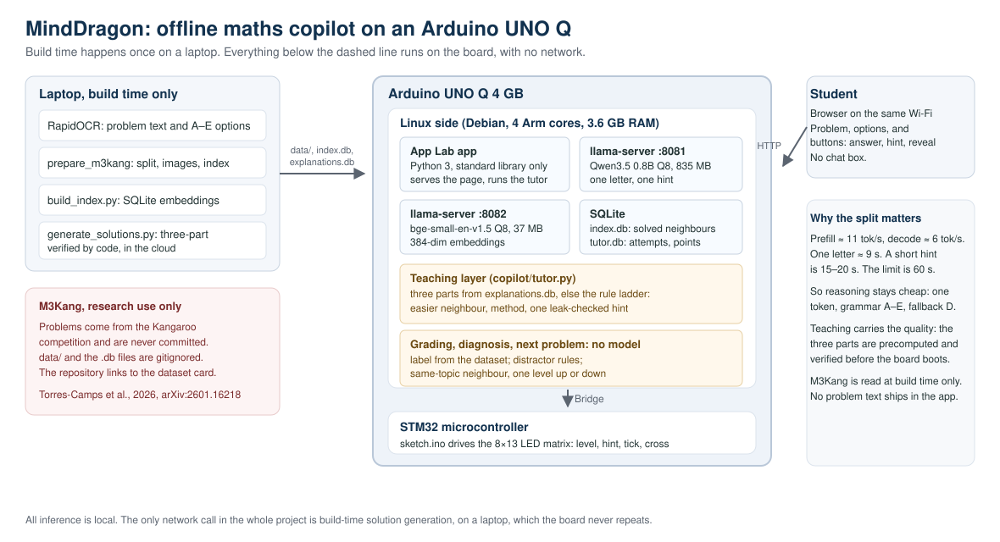

# MindDragon — an offline maths copilot on the Arduino UNO Q

## What it does

A small maths tutor that runs entirely on an Arduino UNO Q 4 GB, with no network
and no cloud. A student reads a Kangaroo problem, answers A–E, and asks for a
hint. The hints come in three cumulative steps — a nudge, the working, the
answer — and the board's 8×13 LED matrix shows a tick, a cross, and the level.

There is no chat box. Every control is a button, because a 0.8B model writing
free-form mathematics on four A53 cores is not a reliable tutor.

What the student gets, all offline:

- **Three cumulative hints.** A nudge, then the working, then the answer only
  on an explicit second press.
- **Diagnosis after a wrong answer.** Rule-based, from the distractor: unit,
  sign, digit swap, off by one, one step short. It says what to check, never
  the answer.
- **Adaptive practice.** Right answers move one level up, wrong ones one level
  down, staying on the same topic when possible. Level and topic are also
  pickers in the header.
- **A streak** that counts clean first-try answers, and **text to speech** for
  the problem and each option, using the browser's offline voices in the page's
  language.
- **End-of-session feedback**: four written sections and six charts built as
  inline SVG, so no plotting library or extra server is needed on the board.

> *Photo: add «docs/photo.jpg», a picture of the board running the copilot, under
> this line before publishing.*

> **Scores, stated up front.** Reasoning is **23.1% on the 562 validation
> problems**, which is exactly the always-`D` floor. The value of this project
> is the teaching half: verified three-part explanations, deterministic
> diagnosis, and a ladder that degrades honestly when nothing is precomputed.

## Architecture



Two halves on one board, plus a laptop that is used once, before the demo.

| Where | What runs |
| --- | --- |
| **Laptop, build time** | RapidOCR over the M3Kang images, the train/val split, the SQLite retrieval index, and the three-part solution generation (a cloud model, verified by code) |
| **Board, Linux side** | The App Lab app (Python 3, standard library only), `llama-server :8081` with Qwen3.5 0.8B Q8, `llama-server :8082` with bge-small-en-v1.5, and SQLite |
| **Board, STM32** | `sketch/sketch.ino` drives the 8×13 LED matrix: the level as a digit on a new problem, the hint number, then a single tick or cross blink; the App Lab Bridge carries the state over to it |
| **Student** | A browser on the same Wi-Fi, hitting the page the app serves on port 7000 |

Four databases and one rule keep it fast:

- `data/index.db` — embeddings of solved problems, used for retrieval and for
  "an easier problem on the same topic".
- `data/explanations.db` — the precomputed three-part solutions, verified offline.
- `data/tutor.db` — the student's attempts and points, never containing the answer they did not find.
- `config.env` — pinned llama.cpp commit, model repo/revision/file/SHA256, ports, time limit, seed, fallback answer.

**What are the models used for?** DeepSeek returns one letter for `predict.py`.
The 0.8B model writes a short hint at the third rung, which is checked before
it is shown. Grading, diagnosis and choosing the next problem do not need a model.

**How M3Kang is used.** At build time only. The problems are never committed
and never shipped: `data/`, `*.db` and `*.gguf` are gitignored. The board reads
the index and the solutions that were derived from them.

The exam command now uses DeepSeek separately from the tutor. See
[the offline exam setup](docs/exam-deepseek.md) for the pinned model, board
launch commands and Discord practice run.

## How to replicate it

Start from a board that has completed **Steps 0 to 12** of the
[datathon guide](docs/datathon-guide.md). That gives you Debian with the build
tools, llama.cpp, both models, the services, and the datathon code on the board.

Then, on the **laptop** (to prepare the data):

```bash
uv venv --python 3.12 .venv
uv pip install --python .venv/bin/python -r laptop/requirements.txt

# M3Kang needs a Hugging Face account that has accepted the dataset licence.
.venv/bin/python laptop/prepare_m3kang.py --languages eng,cat --save-images --workers 8
```

You should end up with `data/train.jsonl`, `data/val.jsonl` and `data/images/`.
The OCR is resumable through `data/.ocr_cache.jsonl`; one image takes about 2.6
seconds.

```bash
.venv/bin/python build_index.py --input data/train.jsonl --db data/index.db --only-with-options
```

On the **board**, copy `data/` across (`scp` or `adb push`), then check everything:

```bash
cd ~/datathon-UPC-maths-qualcomm-arduino-unoq
./board/00_check_board.sh          # read-only health check
./board/05_smoke_test.sh           # predict.py on the sample problems
```

You should see both services healthy on 8081 and 8082, and a CSV of predictions.

Optionally, generate the precomputed solutions (build time, on a laptop, needs
a cloud key; see [`tools/PROVIDERS.md`](tools/PROVIDERS.md)):

```bash
export DEEPSEEK_API_KEY=...
python3 tools/generate_solutions.py --all --out data/explanations.db --name full-v3
```

Then copy `data/explanations.db` to the board. Without it the tutor still works:
every problem falls back to the rule-based ladder.

Finally install and start the app, on the **board**:

```bash
./board/06_install_app.sh --start
```

You should see it listed in App Lab, and the page at
`http://$(hostname -I | awk '{print $1}'):7000`. The LED matrix shows the level
digit when a problem appears, and a tick or a cross when you answer.

**The exam predictor is a different model.** `predict.py` defaults to a local
DeepSeek-R1-Distill-Qwen-1.5B, not the tutor's 0.8B. Put the GGUF in `~/models`,
start it with `bash board/07_start_deepseek.sh`, and check
`curl -fsS http://127.0.0.1:18738/health`. Without that server `predict.py`
answers `D` for every problem with `status=error`. The full setup, including the
optional Tesseract OCR, is in [docs/exam-deepseek.md](docs/exam-deepseek.md);
`predict.py --solver baseline` runs the older 0.8B path instead.

The App Lab container mounts **only the app folder**, so `06_install_app.sh`
copies `copilot/`, `config.env`, `data/index.db` and `data/images` next to the
app (about 150 MB), and keeps `data/tutor.db` across reinstalls. Its
`config.env` sets `MODEL_HOST=172.17.0.1`, the host as seen from inside the
container, and both services therefore listen on more than `127.0.0.1`. If the
page loads but hints fail, that is the first thing to check.

To run the page without the matrix, on the board or a laptop:

```bash
python3 explorer/tutor_server.py --host 0.0.0.0
```

## Results

Every number below is from a run recorded in `results/`, listed with its row in
`results/ablations.csv` where it has one. **Board** means the Arduino UNO Q;
**laptop** means the same code on x86, which is faster and only used to compare
models. A 1–2 answer difference is noise; the full set is 562 problems.

The reference baseline from the datathon guide (step 11) is **22.5% on 40
English problems with OCR options**, at 8.7 s mean.

| Run | Model | Problems | Accuracy | Mean | Worst | Where |
| --- | --- | --- | --- | --- | --- | --- |
| always `D` | — | 562 | 23.1% | 0 s | 0 s | — |
| **baseline** | Qwen3.5 0.8B Q8 | 50, all languages | **20.0%** | **9.4 s** | **15.2 s** | **board** |
| baseline | Qwen3.5 0.8B Q8 | 50, all languages | 22.0% | 0.8 s | 1.3 s | laptop |
| baseline | Qwen3.5 0.8B Q8 | 562, all languages | 23.1% | 1.3 s | 10.8 s | laptop |
| RAG k=1..4 | 0.8B + retrieval | 50 each | 12.0–18.0% | 3.4–8.8 s | up to 21.8 s | laptop |
| Qwen2.5-Math 1.5B | Q4_K_M | 50 | 16.0% | 1.2 s | 2.2 s | laptop |
| Qwen3.5 2B | Q4_K_M | 50 / 562 | 22.0% / 22.1% | 1.5 s | 3.2 s | laptop |
| Qwen2.5 3B | Q4_K_M | 562 | 24.6% | 2.5 s | 5.9 s | laptop |
| Qwen2.5 3B, options only | Q4_K_M | 339 with options | 28.3% | — | — | laptop |
| permutation averaging (2 orders) | 0.8B | 562 | 22.4% | 2.1 s | 22.4 s | laptop |
| Jev-Vision 0.8B | GGUF | 339 with options | 21.8% | 2.05 s | 7.6 s | laptop CPU |
| Jev-Vision 2B | GGUF | 339 with options | 24.8% | 6.51 s | 25.5 s | laptop CPU |
| Laya multilingual, zero-shot | 322M | 339 with options | 19.2% | — | — | laptop GPU |

The one run that beats the baseline in a way worth mentioning is the **3B on
problems with options: 28.3%, p = 0.08** (McNemar, not significant). It is
**not deployable**: on the board it timed out on **6 of 10** problems, median
**57.1 s**. A 3B-plus-`D` hybrid reaches 27.4% overall (p = 0.14), also
unestablished.

**The exam scorer is a separate model.** `predict.py` now defaults to a locally
served **DeepSeek-R1-Distill-Qwen-1.5B IQ3_M** (see
[the offline exam setup](docs/exam-deepseek.md)), with runtime OCR and a 57 s
wall deadline. It has **no published board measurement yet**, so it is not in
the table above: every number there comes from the Qwen3.5 0.8B baseline, which
`--solver baseline` still reproduces exactly. Until the DeepSeek run is measured
on the board, quote the baseline, not the default.

**Teaching layer cost.** The precomputed path was measured at **0.0 s** (a
SQLite read). Rungs 1–2 are a local embedding search plus keyword matching,
which is well under a second on the laptop and bounded by the same search on the
board. Rung 3 is the only slow path: one short generation, **estimated at 15–20 s
on the board** from its measured decode speed of about 6 tokens per second. A
full board measurement with `tools/tutor_measure.py` is still pending, and the
numbers above are marked accordingly.

Precomputed coverage after the current batch: **419 verified rows, 224 problems
(15.3% of train), 195 of them in both English and Catalan**. Solution
generation accepted **94 of 100 rows** at **$0.0075 per row** in the last
measured batch.

## Error analysis

From the full 562-problem baseline run (`tools/error_analysis.py`), 130/562 =
23.1%.

| Level | Correct | Problems | Accuracy |
| --- | --- | --- | --- |
| 0 | 13 | 40 | 32.5% |
| 1 | 14 | 34 | 41.2% |
| 2 | 20 | 58 | 34.5% |
| 3 | 2 | 24 | **8.3%** |
| 4 | 27 | 124 | 21.8% |
| 5 | 23 | 106 | 21.7% |
| 6 | 14 | 98 | 14.3% |
| 7 | 17 | 78 | 21.8% |

| Language | Correct | Problems | Accuracy |
| --- | --- | --- | --- |
| English | 66 | 281 | 23.5% |
| Catalan | 64 | 281 | 22.8% |

| OCR options | Correct | Problems | Accuracy |
| --- | --- | --- | --- |
| available | 74 | 339 | 21.8% |
| missing | 56 | 223 | 25.1% |

| Topic | Correct | Problems | Accuracy |
| --- | --- | --- | --- |
| geometry | 40 | 199 | 20.1% |
| general | 23 | 96 | 24.0% |
| arithmetic | 17 | 72 | 23.6% |
| number theory | 12 | 41 | 29.3% |
| measurement | 10 | 42 | 23.8% |
| logic | 3 | 25 | 12.0% |
| patterns | 5 | 20 | 25.0% |
| counting | 5 | 15 | 33.3% |
| fractions | 3 | 12 | 25.0% |
| money | 1 | 12 | 8.3% |
| rate | 4 | 8 | 50.0% |
| algebra | 2 | 7 | 28.6% |
| statistics | 0 | 5 | 0.0% |
| probability | 3 | 4 | 75.0% |
| time | 2 | 4 | 50.0% |

Three things to read from this:

1. **Level 3 is the weak spot, at 8.3%.** That level is figure-heavy and its
   options survive OCR less often, so the model is solving problems it can only
   partly read.
2. **Accuracy tracks the OCR, not the language.** English and Catalan are within
   one point; problems *with* options score lower than problems without, because
   OCR failures cluster in the harder, image-based problems.
3. **The letter bias is the real failure.** On 562 problems the model answered
   `D` far more often than the answer actually was, and predicted `C` and `E`
   almost never. That is why the score matches always-`D` so closely: it is
   often guessing, not reasoning.

Two representative failures, described without reproducing the problem text:

- A level-3 figure problem lost two of its five options to OCR, leaving a
  duplicate value. The model picked a letter that mapped to the surviving
  option; the missing options were never recoverable, so no answer could be
  right. This is an OCR failure, not a reasoning failure.
- A multi-step level-6 problem was answered with the value from the *second*
  step — the classic "one step short" distractor. The model stops when the
  arithmetic looks finished, which is exactly why the tutor's diagnosis has an
  `one_step` rule.

## What didn't work

Every one of these is a measured run, not an opinion.

- **Larger off-the-shelf models.** 1.5B chains of thought truncated before the
  answer; the 2B reached 22.1% and was no better; the 3B reached 24.6% overall
  (28.3% with options, p = 0.08) but **timed out on the board**. A 7B does not
  fit in 4 GB at all.
- **Permutation averaging.** Answering twice with the options in a different
  order took 23.1% down to 22.4%.
- **Retrieval as a reasoning boost.** RAG k=1..4 scored 12–18% on 50 problems,
  below no-retrieval. Retrieval helps the *teaching* layer, not the letter.
- **Letter debiasing.** Correcting the model's answer distribution did not move
  accuracy; the content signal is the bottleneck, not the bias.
- **Small chain-of-thought, two-stage.** A first call limited to 60–120 tokens,
  then a forced one-letter call: the 1.5B scored 0/5 (all `A`), the 2B 1/5. The
  models ignore brevity instructions and the reasoning is truncated before any
  conclusion.
- **Decision models** (Jev-Vision, OneJev, Laya) scored 19.5–24.8% zero-shot on
  problems with options. They are fast, but they are classifiers, not reasoners.
- **Runtime model-generated explanations.** They produced invented numbers and
  wrong operations. Diagnosis is rule-based instead, and the explanations are
  precomputed and verified.
- **Trusting the model's output.** The verifier for precomputed solutions
  initially rejected ~30 good rows for bad reasons (fractions read as the last
  number, `48/6` read as `8`, `4°` found inside `324°`). Those rules are now
  covered by `tools/tutor_checks.py` and by rechecking the whole database offline.

What we would try next: a fine-tune of a 322M encoder on the labelled pairs
(time-boxed), a deterministic option-value solver with **abstain** to `D`, and
more precomputed solutions — the cheapest quality gain, at $0.0075 per problem.

## The team

- Àlex Xavier Touza Luque
- Jaume Querol Redó
- Eloi Buil Cuadrat

Datathon 2026, UPC Mathematics + Qualcomm + Arduino, "Math on the Edge".

## Licence and credits

The team's code is **MIT** (see [LICENSE](LICENSE)). The dependencies keep their
own licences:

- **M3Kang** — Torres-Camps et al., 2026, [arXiv:2601.16218](https://arxiv.org/abs/2601.16218), Qualcomm.
  [Dataset card](https://huggingface.co/datasets/qualcomm/M3Kang): research use only.
  Problem text and images are **not** in this repository.
- **llama.cpp** — [ggml-org/llama.cpp](https://github.com/ggml-org/llama.cpp), MIT.
- **Qwen3.5 0.8B** — [bartowski GGUF](https://huggingface.co/bartowski/Qwen_Qwen3.5-0.8B-GGUF).
- **bge-small-en-v1.5** — [CompendiumLabs GGUF](https://huggingface.co/CompendiumLabs/bge-small-en-v1.5-gguf), BAAI.
- **RapidOCR** — [RapidAI/RapidOCR](https://github.com/RapidAI/RapidOCR), Apache 2.0.
- For generative AI on this board, see Marcelo Rovai's
  [Generative AI at the Edge](https://mjrovai.github.io/genai-uno-q/).
