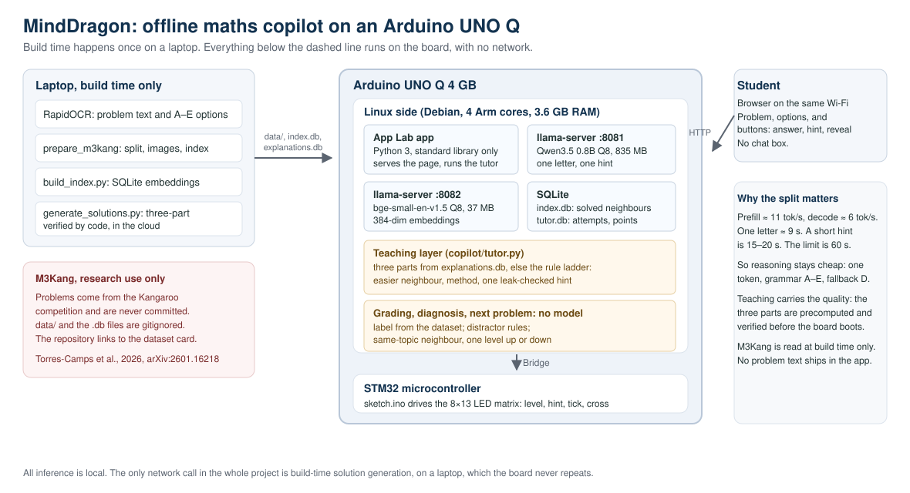

# MindDragon — an offline maths tutor on the Arduino UNO Q

<!--
INTERNAL NOTES — do not paste this block into Project Hub.

Form fields:
  Title:        MindDragon: an offline maths tutor on the Arduino UNO Q
  Subtitle:     A Kangaroo maths copilot that hints, diagnoses and adapts, with no network
  Cover image:  a photo of the board with the page open and the LED matrix lit
  Difficulty:   Advanced
  Time:         a weekend (the llama.cpp build alone is about 30 minutes)
  License:      MIT

Before posting: the GitHub link below must be public, the cover photo and a short
video must be uploaded, and the architecture SVG must be added as an image in the
editor (the Hub does not render markdown images from the repository).
-->

## Introduction

Students preparing for the Kangaroo maths competition often practise alone,
with an answer key and no feedback. A tutor would say *what should I look at
first?*, *where did I go wrong?*, *what is the next step?* — not just *the
answer is C*.

Cloud assistants can do that, but they need a network, they cost money per
question, and they cannot be used in a classroom or an exam room without Wi-Fi.

This project puts the tutor on an Arduino UNO Q 4 GB. It runs with the network
off. A student reads a problem, picks A–E, and presses a button for a hint. The
hints come in three cumulative steps, and the board's LED matrix shows the level
as a digit, then a tick or a cross when the student answers.

Around that core: a rule-based diagnosis of the wrong option, a streak for clean
first-try answers, offline text to speech for the problem and the options, level
and topic pickers, and an end-of-session report with six charts drawn as SVG, so
the board needs no plotting library.

One design decision shapes everything else: **the small model is not trusted to
explain mathematics.** The explanations are generated once, on a laptop,
verified by code, and installed on the board as data. At run time a 0.8B model
does two things only: pick one letter, and write at most one short hint, which is
checked before the student sees it.

## Things used in this project

**Hardware**

- Arduino UNO Q 4 GB (Qualcomm QRB2210, four Arm cores, 3.6 GB usable RAM, plus
  an STM32 microcontroller with an 8×13 LED matrix)

**Software**

- Arduino App Lab, with one app and the `arduino:web_ui` brick
- llama.cpp, built natively on the board
- Qwen3.5 0.8B, Q8_0 (835 MB), for one letter and one short hint
- bge-small-en-v1.5, Q8_0 (37 MB), for retrieval embeddings
- Python 3, standard library only, on the board
- M3Kang (research use only) as the problem bank, read at build time only

## Architecture

Two halves on one board, plus a laptop that is used once, before the demo.

- **Linux side.** The App Lab app serves the page and runs the tutor. Two
  `llama-server` processes answer on ports 8081 and 8082. SQLite holds the
  retrieval index, the precomputed explanations and the practice profile.
- **STM32.** A small sketch draws on the 8×13 LED matrix: the level digit when a
  problem appears, then a tick or a cross. The App Lab Bridge carries the state
  across.
- **Laptop, build time.** OCR the dataset, build the index, generate the
  three-part explanations with a cloud model, verify them with code, and copy the
  result to the board. Nothing at demo time touches the network.

Four rules keep it inside four cores and 60 seconds per problem:

1. The model answers with **one token**, under a grammar that only allows A–E.
2. Explanations are **precomputed**, so a hint costs a SQLite read instead of a
   generation.
3. Diagnosis and next-problem selection are **rules**, not model calls.
4. Every client is **offline**: the page, the speech and the charts.

## Step by step

**1. Get a board to a working llama.cpp.** Follow the datathon guide in the
repository (`docs/datathon-guide.md`, steps 0–12). You should have both model
services answering on ports 8081 and 8082, and a first prediction from
`predict.py`.

**2. Prepare the data on a laptop.** Accept the M3Kang licence on Hugging Face,
then run `laptop/prepare_m3kang.py --languages eng,cat --save-images`. You should
get `data/train.jsonl`, `data/val.jsonl` and one image per problem. OCR is
resumable if it stops.

**3. Build the retrieval index.** Run `build_index.py`. You should get
`data/index.db` with one row per training problem that has readable options.

**4. Copy the data to the board** with `scp` or `adb push`.

**5. Check the board.** Run `./board/00_check_board.sh` and
`./board/05_smoke_test.sh`. You should see a CSV of predictions with no timeouts.

**6. Generate the explanations (optional).** On a laptop, with any
OpenAI-compatible cloud key, run `tools/generate_solutions.py --all`. It writes
`data/explanations.db` containing only the rows that pass the verifier. Copy it
to the board. Skip this step and the tutor still runs: every problem falls back
to the rule-based ladder.

**7. Install the app.** Make sure the solutions database is at
`data/explanations.db` (rename it if you generated it under another name), then
run `./board/06_install_app.sh --start`. Open
`http://<board-ip>:7000` on a phone or laptop on the same Wi-Fi. You should see a
problem, five options, and hint and reveal buttons. Answer it: the LED matrix
shows a tick or a cross.

## Results

Reasoning is honest but weak: **23.1% on all 562 validation problems**, which is
exactly the score of always answering `D`. On the board, over 50 problems, the
same model scores **20.0%**, at 9.4 s mean and 15.2 s worst.

| Model | Problems | Accuracy | Fits the board |
| --- | --- | --- | --- |
| Qwen3.5 0.8B (the tutor's model, and the baseline) | 562 | 23.1% | yes, about 9 s |
| Qwen3.5 2B | 562 | 22.1% | yes, no gain |
| Qwen2.5-Math 1.5B | 50 | 16.0% | yes, worse |
| Qwen2.5 3B | 562 | 24.6% | **no: 6 of 10 timeouts, 57 s median** |
| Qwen2.5 3B, options only | 339 | 28.3% (p = 0.08) | no |
| DeepSeek-R1-Distill-Qwen-1.5B (the new exam default) | — | not measured on the board yet | unknown |

Error analysis over the full run:

- **Level 3 is the worst, at 8.3%** — figure-heavy problems, whose options
  survive OCR least often.
- **Language makes no difference**: English 23.5%, Catalan 22.8%.
- **Problems with OCR options score lower** (21.8%) than problems without
  (25.1%), because OCR failures cluster in the hard, image-based problems.
- **The model has a letter bias**: it predicted `C` and `E` almost never, and `D`
  far more often than the truth. On this task that is guessing.

The teaching layer is where the project earns its keep. **437 verified
explanations, over 231 problems, 206 of them in both English and Catalan.** The
cached path appears in about 0 s because it is a database read. Generating them
costs about **$0.0075 per problem** on a cloud model, once, at build time.

## What we learned

- **A 0.8B model cannot be a maths tutor.** It does not reliably chain three
  arithmetic steps, and it sounds equally confident when wrong. Confident wrong
  mathematics is worse than no explanation.
- **Precompute what matters, verify what you precompute.** About 30 good
  explanations were initially thrown away because the checks misread fractions
  and units. The fix was not a better model, it was better checks.
- **Check the model's output against the problem, not against the answer.**
  Testing the app turned up two real defects: five English rows that were
  written in Catalan, and a hint that said *"she starts with 10 sheets"* for a
  problem with 3 + 2 + 2 sheets. A language check and a "no number the problem
  does not give" check caught both, and both fall back to the method hint.
- **Make the fallback good.** For problems without a precomputed solution, the
  ladder is: an easier solved neighbour, then the topic method, then one
  checkable model hint. It degrades visibly, which is better than pretending.
- **The 60-second limit is a prefill limit.** A 3B model times out on this board
  before it finishes reading the problem, so the interesting work happens off
  the board.

Next: a time-boxed fine-tune of a 322M encoder on the labelled pairs, and a
deterministic option-value solver that abstains to `D` when it is not sure. Both
are attempts to leave the always-`D` floor without a bigger model.

## Code and credits

Everything is in the repository:
**https://github.com/alex-touza/datathon-2026-qualcomm**

M3Kang: Torres-Camps et al., 2026, [arXiv:2601.16218](https://arxiv.org/abs/2601.16218),
Qualcomm. Research use only; the dataset is not redistributed here.
llama.cpp: MIT. Qwen3.5 0.8B and bge-small-en-v1.5: see their model cards.
RapidOCR: Apache 2.0. The team's code: MIT.
